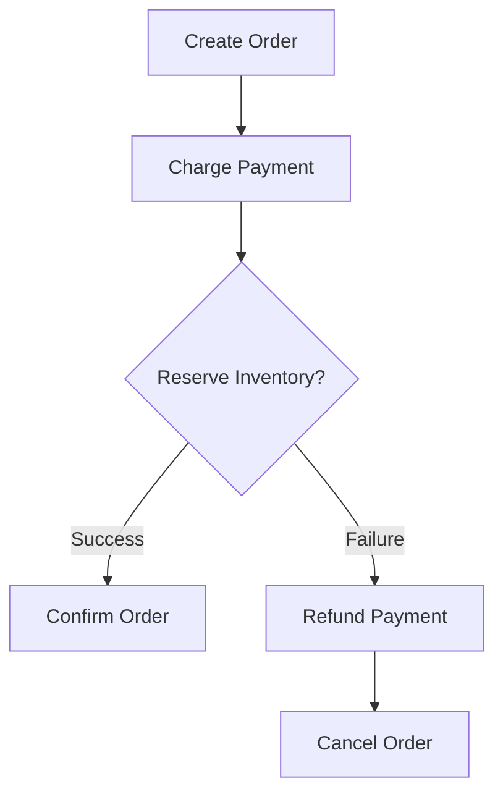
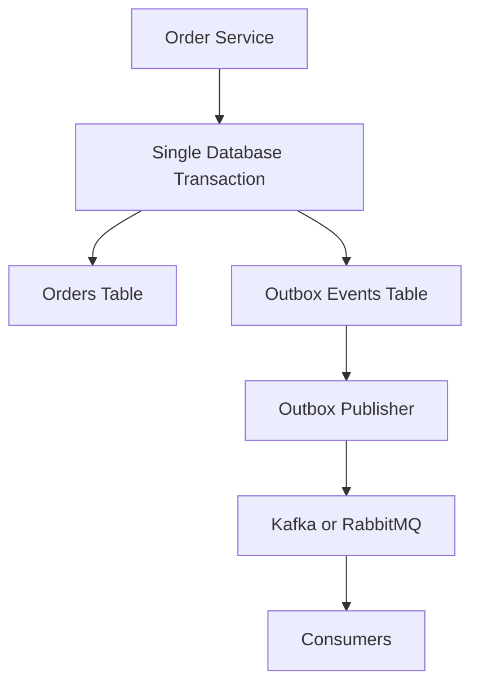
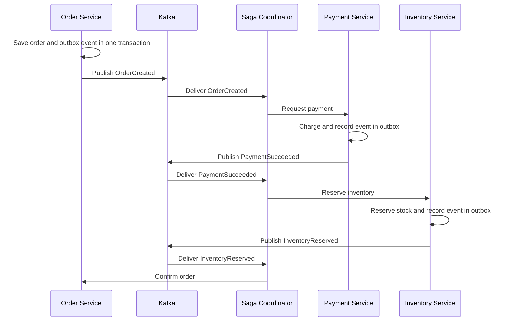

# Saga Pattern and Outbox Pattern

## 1. Saga Pattern

The Saga Pattern coordinates a sequence of local transactions across multiple microservices. If a step fails, compensating transactions undo the business effects of previously completed steps.

### Example: Order Processing



### Types of Saga

**Choreography:** Services communicate through events without a central coordinator.

**Orchestration:** A central Saga orchestrator controls the workflow and invokes compensating actions when necessary.

### Java Example

```java
public void placeOrder(Order order) {
    orderService.createPendingOrder(order);

    try {
        paymentService.charge(order.getId(), order.getAmount());
        inventoryService.reserve(order.getId(), order.getProductId());
        orderService.markConfirmed(order.getId());
    } catch (Exception ex) {
        paymentService.refundIfCharged(order.getId());
        orderService.cancel(order.getId());
        throw ex;
    }
}
```

This is illustrative pseudocode. Production implementations need durable Saga state, retries, idempotency, and recovery from ambiguous network failures.

## 2. Outbox Pattern

The Outbox Pattern solves the dual-write problem: updating a database and publishing a message cannot generally be committed atomically as two independent operations.

The service writes its business data and an event record to the same database transaction. A separate publisher sends the event to a message broker.

### Architecture



### PostgreSQL Schema

```sql
CREATE TABLE orders (
    id UUID PRIMARY KEY,
    customer_id UUID NOT NULL,
    amount DECIMAL(10, 2) NOT NULL,
    status VARCHAR(30) NOT NULL
);

CREATE TABLE outbox_events (
    id UUID PRIMARY KEY,
    aggregate_id UUID NOT NULL,
    event_type VARCHAR(100) NOT NULL,
    payload JSONB NOT NULL,
    created_at TIMESTAMPTZ NOT NULL DEFAULT NOW(),
    published_at TIMESTAMPTZ
);
```

### Spring Java Example

```java
@Transactional
public void createOrder(Order order) {
    orderRepository.save(order);

    OutboxEvent event = new OutboxEvent(
        UUID.randomUUID(),
        order.getId(),
        "OrderCreated",
        createPayload(order)
    );

    outboxRepository.save(event);
}
```

Both writes must use the same database transaction. If either write fails, both should roll back.

A separate publisher reads pending events and sends them to Kafka. It must await broker acknowledgments and handle retries and duplicate publication.

### Polling vs. CDC

- **Polling:** Periodically query pending outbox records and publish them.
- **CDC:** Capture committed database changes from the transaction log. Debezium is a common choice for publishing outbox events to Kafka.

## 3. Saga vs. Outbox

| Aspect | Saga | Outbox |
|---|---|---|
| Problem | Partial failure across services | Database/message dual writes |
| Purpose | Coordinate business workflows | Reliably publish recorded events |
| Mechanism | Local transactions and compensation | Business data and event in one transaction |
| Failure handling | Retry, compensate, recover | Retry publication and deduplicate |
| Components | Orchestrator or event-driven services | Database, outbox, publisher, broker |
| Example | Refund payment if inventory fails | Publish OrderCreated reliably |

## 4. How They Work Together



If inventory reservation fails, the Saga requests a refund and cancels the order. Each service can use its own outbox to publish events reliably.

## 5. Production Considerations

- **Idempotency:** Consumers must safely handle duplicate events and commands.
- **Retries:** Use bounded retries, exponential backoff, and a dead-letter or manual-recovery strategy.
- **Durable state:** Persist Saga progress so it can resume after a restart.
- **Compensation:** Define what happens if a refund or another compensating action fails.
- **Ordering:** Use aggregate IDs as message keys when per-aggregate ordering is required.
- **Monitoring:** Track outbox lag, failed publications, and stuck Sagas.
- **Delivery guarantees:** Outbox does not automatically provide exactly-once delivery. At-least-once delivery with idempotent consumers is a common approach.

## 6. When to Use Each Pattern

### Saga

Use it when a business workflow spans multiple services and needs compensation or recovery.

Examples: checkout, travel booking, money transfers.

### Outbox

Use it when a service must update its database and reliably publish an event.

Examples: OrderCreated, PaymentSucceeded, ShipmentDispatched.

### Both

Use both when distributed workflows depend on reliable asynchronous messaging.

## 7. Key Takeaway

- **Saga:** What should happen next, and how do we recover if a step fails?
- **Outbox:** How do we ensure a committed database change has a durable event waiting to be published?

Together, they help build reliable, eventually consistent microservices.
